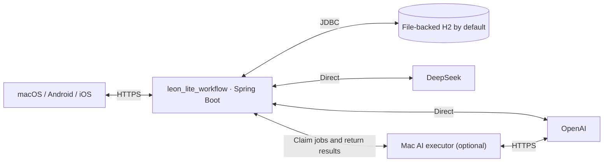

# Leon

[简体中文](README.md) · English

Leon is a native chat app for macOS, Android, and iOS. Upload an Excel file from your phone, ask an AI Agent to summarize it, then open the file and the Agent’s reply on your Mac to continue the discussion.

## Quickstart

Get the **HTTPS address, access token**, and a compatible installer from your service administrator. You can also [build from source](#build-from-source).

1. **Install the client.** On macOS, unzip the download and move `Leon.app` to Applications. On Android, install the debug APK on a development device. For an iOS device, use a valid signed build for that device or configure signing and install from Xcode.
2. **Connect to the service.** Open Settings and enter the HTTPS address and access token. On macOS, enter a device name in Connection (「连接」) and click Verify and Connect (「验证并连接」). On Android and iOS, enter your `UserName` under Register or Sign In (「注册或登录」).
3. **Verify your first message.** Send a text message in the device chat or a group you can access. Open the same conversation on a second authorized device and check that the message appears.
4. **Try an Agent.** Select a configured Agent from the Agents list to start a direct chat, or type `@` in a group to choose an Agent available there. Administrators configure models and tools in the backend’s Agent Workbench (「Agent 工作台」) at `/workspace/agents.html`.

## Features

| Use case | What you can do |
| --- | --- |
| Chat across devices | Sync text, images, and files in your personal device chat, custom groups, or named Agent chats. Load older messages as needed. |
| Analyze files with AI | Send PDFs, Word and Excel files, plain text, Markdown, and CSV. Messages render Markdown, code blocks, math, and Mermaid diagrams. |
| Revisit and continue discussions | Search across chats or within a conversation, jump to the original message, quote it, save it as a favorite, or branch from a sent message with its history and attachments. View context summaries or start a new topic. |
| Back up, archive, and check usage | Export or restore chat backups and review token usage and estimated costs. On macOS, use the `leonbook` CLI to save a summary, complete Markdown transcript, and attachments as a LeonBook draft. |

## Architecture

The macOS client uses SwiftUI, iOS uses SwiftUI / UIKit, and Android uses native Java UI. All three bundle the same rich-text rendering assets. The separate Spring Boot backend, `leon_lite_workflow`, checks account and conversation access, manages messages, attachments, and Agent jobs, and uses file-backed H2 by default.



Clients save pending messages before sending and reuse the client message ID on retries so the backend can deduplicate them. The backend runs Agent jobs asynchronously, saves replies to the conversation, and serves incremental updates by message ID. OpenAI requests can go directly from the backend or through the separate Mac AI executor, which returns the result to the backend.

## Feature requirements

| Capability | Requirements |
| --- | --- |
| Document analysis, branching, structured memory, and backups | The client and backend must support the required APIs. After uploading a document, ask the Agent about it in the same conversation. |
| Image understanding, web search, and image generation | Use an OpenAI model that supports the capability. Enable web search and image generation separately in the Agent Workbench. |
| Mobile background notifications | Grant notification permission and configure backend push. iOS uses APNs. Android uses supported vivo devices. |
| LeonBook archiving | Install and configure the `leonbook` CLI on macOS and use a backend that supports archiving. |

See the [development and release history](docs/project-history.md) for deployment versions and verification records.

## Build from source

Run the command for your platform from the repository root. Build outputs go to the local `dist/` directory.

| Platform | Minimum OS | Build requirements | Command | Output |
| --- | --- | --- | --- | --- |
| macOS | macOS 13 | macOS Swift toolchain, Apple-issued signing certificate | `bash scripts/build-macos.sh` | `dist/Leon.app`, `dist/Leon-macOS.zip` |
| Android | Android 8.0 (API 26) | JDK 17+, Android SDK Platform 35, Build Tools 35 | `bash scripts/build-android.sh` | `dist/Leon-android-debug.apk` |
| iOS | iOS 16 | Full Xcode installation, Node.js 22.12+ with npm, Python 3 | `bash scripts/build-ios.sh device` | `dist/Leon-iOS-device-unsigned.zip` |

- **macOS.** Set `LEON_CODESIGN_IDENTITY` and `LEON_CODESIGN_TEAM_ID` for your certificate and team. Before replacing Leon, save unsent work and quit with `⌘Q`. After relaunching, check the running process and its executable, then open a LeonBook export to verify it.
- **Android.** Set `ANDROID_HOME` or configure the SDK in `android/local.properties`. The build script also runs unit tests and lint.
- **iOS.** The device ZIP contains an unsigned app. Open `ios/Leon.xcodeproj` in Xcode, configure signing for the `Leon` scheme, and run it on the device. Use `bash scripts/build-ios.sh simulator` for the simulator. See the [iOS development guide](ios/README.md) for setup and signing.

## Development checks

```bash
bash scripts/test-macos.sh
bash scripts/test-ios-core.sh
```

After changing the shared Markdown renderer, run `npm ci`, `npm run build`, and `npm test` in `shared/markdown`. Renderer tests use a local Chrome installation. Set `LEON_CHROME` to specify the executable.

## Repository layout

| Directory | Contents |
| --- | --- |
| [`macos/`](macos/) | SwiftUI client and Swift package |
| [`android/`](android/) | Native Java client and Gradle project |
| [`ios/`](ios/) | SwiftUI / UIKit client and Xcode project |
| [`shared/markdown/`](shared/markdown/) | Source and offline assets for Markdown, KaTeX, and Mermaid |
| [`scripts/`](scripts/) | Build, packaging, and verification scripts |

## Related documentation

- [Document attachments and message notifications (Chinese)](docs/documents-and-notifications.md)
- [Agent web search setup and limits (Chinese)](docs/agent-web-search.md)
- [Backend compatibility patches](ios/ServerCompatibility/)
- [Development and release history (Chinese)](docs/project-history.md)
