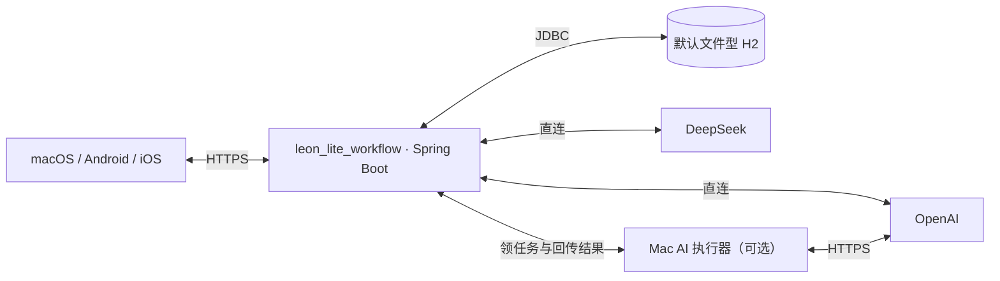

# Leon

简体中文 · [English](README.en.md)

Leon 是面向 macOS、Android 和 iOS 的原生聊天应用。可以在手机上传 Excel，请 AI Agent 汇总数据，再到 Mac 查看原件和回复、继续讨论。

## 快速开始

先准备服务管理员提供的 **HTTPS 地址、访问令牌**和适用于设备的客户端安装包。也可以[从源码构建](#从源码构建)。

1. **安装客户端。** macOS 解压后将 `Leon.app` 拖入「应用程序」。Android 可在开发设备上安装调试 APK。iOS 真机请使用与设备匹配且签名有效的版本，或在 Xcode 中配置签名后安装。
2. **连接服务。** 打开设置，填写 HTTPS 地址和访问令牌。macOS 在「连接」中填写设备名称，再点「验证并连接」。Android 和 iOS 在「注册或登录」中填写 `UserName`。
3. **验证第一条消息。** 在设备群聊或已有权限的群聊发一条文字，再在另一台有权限的设备打开同一会话，确认能看到这条消息。
4. **试用 Agent。** 在 Agents 列表选一个已配置的 Agent 开始私聊，或在群聊输入 `@` 选择该群可用的 Agent。管理员在服务端的「Agent 工作台」（`/workspace/agents.html`）配置模型和工具。

## 主要功能

| 场景 | 能力 |
| --- | --- |
| 跨设备沟通 | 同步文字、图片与文件。支持个人设备群聊、自建群聊和命名的 Agent 私聊，并可分页查看更早历史。 |
| 用 AI 分析资料 | 发送 PDF、Word、Excel、文本、Markdown 和 CSV。消息正文支持 Markdown、代码块、数学公式和 Mermaid 图表。 |
| 回查并延续讨论 | 搜索全部或当前会话、跳回原消息、引用、收藏，或从一条已发送消息创建带历史和附件的独立分支。可查看上下文摘要或开启新话题。 |
| 备份、归档与用量 | 导出或恢复聊天备份，查看 Token 用量和费用估算。macOS 可通过 `leonbook` CLI 将总结、完整 Markdown 原文和附件保存为 LeonBook 草稿。 |

## 技术架构

macOS 使用 SwiftUI，iOS 使用 SwiftUI / UIKit，Android 使用 Java 原生界面。三端共用随应用打包的富文本渲染资源。独立的 Spring Boot 服务 `leon_lite_workflow` 校验账号和会话权限，管理消息、附件和 Agent 任务，数据库默认使用文件型 H2。



客户端在提交前保存待发消息，重试复用客户端消息 ID，由服务端去重。服务端异步处理 Agent 任务，把回复写入会话，三端按消息 ID 增量拉取。OpenAI 可由服务端直连，也可由独立的 Mac AI 执行器调用并回传结果。

## 功能启用条件

| 能力 | 使用条件 |
| --- | --- |
| 文档分析、分支、结构化记忆和备份 | 客户端及服务端均需支持对应接口。上传文档后，可在同一会话中向 Agent 提问。 |
| AI 看图、联网搜索和绘图 | 需要支持对应能力的 OpenAI 模型。联网搜索和绘图在 Agent 工作台分别开启。 |
| 后台推送 | 需要客户端授权和服务端配置。iOS 使用 APNs，Android 使用兼容 vivo 设备。 |
| LeonBook 归档 | macOS 需要安装并配置 `leonbook` CLI，服务端需支持归档。 |

具体部署版本与验收记录见[开发与发布记录](docs/project-history.md)。

## 从源码构建

在仓库根目录执行相应命令，构建产物写入本地 `dist/`。

| 平台 | 最低系统 | 构建环境 | 命令 | 构建产物 |
| --- | --- | --- | --- | --- |
| macOS | macOS 13 | macOS Swift 工具链、Apple 签发的签名证书 | `bash scripts/build-macos.sh` | `dist/Leon.app`、`dist/Leon-macOS.zip` |
| Android | Android 8.0（API 26） | JDK 17+、Android SDK Platform 35、Build Tools 35 | `bash scripts/build-android.sh` | `dist/Leon-android-debug.apk` |
| iOS | iOS 16 | 完整 Xcode、Node.js 22.12+（含 npm）、Python 3 | `bash scripts/build-ios.sh device` | `dist/Leon-iOS-device-unsigned.zip` |

- **macOS。** 用 `LEON_CODESIGN_IDENTITY` 和 `LEON_CODESIGN_TEAM_ID` 指定证书与团队。覆盖安装前保留未发送内容，用 `⌘Q` 退出旧版。换包后重新打开，核对运行进程和加载的可执行文件，并读回 LeonBook 导出结果。
- **Android。** 通过 `ANDROID_HOME` 或 `android/local.properties` 指定 SDK。构建脚本同时运行单元测试和 lint。
- **iOS。** 真机 ZIP 内含未签名的 App。用 Xcode 打开 `ios/Leon.xcodeproj`，为 `Leon` scheme 配置签名并运行。模拟器构建使用 `bash scripts/build-ios.sh simulator`。完整步骤见 [iOS 开发说明](ios/README.md)。

## 开发检查

```bash
bash scripts/test-macos.sh
bash scripts/test-ios-core.sh
```

修改共享 Markdown 渲染器后，在 `shared/markdown` 中运行 `npm ci`、`npm run build` 和 `npm test`。渲染测试使用本机 Chrome，可用 `LEON_CHROME` 指定可执行文件。

## 仓库结构

| 目录 | 内容 |
| --- | --- |
| [`macos/`](macos/) | SwiftUI 客户端和 Swift Package |
| [`android/`](android/) | Java 原生客户端和 Gradle 工程 |
| [`ios/`](ios/) | SwiftUI / UIKit 客户端和 Xcode 工程 |
| [`shared/markdown/`](shared/markdown/) | Markdown、KaTeX 和 Mermaid 的源码与离线资源 |
| [`scripts/`](scripts/) | 构建、打包与检查脚本 |

## 相关文档

- [文档附件与消息通知](docs/documents-and-notifications.md)
- [Agent 联网搜索的配置与限制](docs/agent-web-search.md)
- [服务端兼容补丁](ios/ServerCompatibility/)
- [开发与发布记录](docs/project-history.md)
